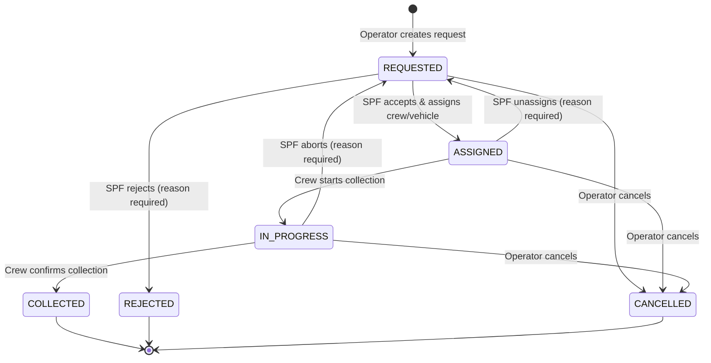

# SPF Request Service: Functional Requirements

| | |
|---|---|
| **Student** | Nkengbeza Clinton |
| **Course** | Distributed Systems & Cloud Computing |
| **System** | Distributed Waste Management System (DWMS), capstone in Distributed Systems & Cloud Computing |
| **Service** | SPF Request Service (`services/requests/`): dispatch of the SPF to waste locations and request lifecycle management |
| **Objective(s)** | 3: a cloud service to view, update the map and request the SPF in real time |
| **Repository** | <https://github.com/nkengbeza/Distributed-Waste-Management-System> |
| **Collaborators** | API Gateway, Location Reporting Service, Real‑Time Channel, Notification Worker |
| **Status** | Draft |

Requirement keywords **SHALL** (mandatory), **SHOULD** (recommended) and **MAY** (optional) follow <a href="https://www.rfc-editor.org/rfc/rfc2119">RFC 2119</a>. Each requirement has a stable ID (`FR-SPF-xx`) so tests, issues and PRs can reference it. Abbreviations and terms are defined in [§9](#9-abbreviations--definitions).

---

## 1. Scope

The SPF Request Service creates collection requests that dispatch the SPF (waste‑collection service provider) to a specific waste location, manages each request through its lifecycle, records an audit trail, and publishes status changes so connected clients update without refresh.

Out of scope: storing waste locations (Obj. 1, `services/locations`), map styling (Obj. 2, `services/map`), and delivering email/SMS/push (`services/notifications`).

---

## 2. Actors & Roles

| Actor | Description | Permitted actions |
|-------|-------------|-------------------|
| **Operator** | Municipal/district operations staff using the dashboard | Create, view, cancel requests in their tenant |
| **SPF Agent** | Staff of the service provider (via dashboard or webhook callback) | Accept/reject, assign, unassign, start, abort, complete requests dispatched to them |
| **Citizen / Field Agent** | Reporter of waste locations | View status of requests linked to locations they reported (read‑only) |
| **Administrator** | Tenant or platform admin | All operator actions plus the per‑tenant SLA override |
| **System** | Internal services and scheduled jobs | SLA checks, event publication, location bucket reset |

---

## 3. Request Lifecycle

| From | To | Allowed actor | Preconditions |
|------|----|---------------|---------------|
| — | `REQUESTED` | Operator, Administrator | Waste location exists, belongs to caller's tenant, has no other open request |
| `REQUESTED` | `ASSIGNED` | SPF Agent | Assignee (crew and/or vehicle) supplied |
| `REQUESTED` | `REJECTED` | SPF Agent | Non‑empty reason |
| `REQUESTED` / `ASSIGNED` / `IN_PROGRESS` | `CANCELLED` | Operator, Administrator | Non‑empty reason |
| `ASSIGNED` / `IN_PROGRESS` | `REQUESTED` | SPF Agent | Non‑empty reason (e.g. road impassable on arrival); assignee cleared |
| `ASSIGNED` | `IN_PROGRESS` | SPF Agent | — |
| `IN_PROGRESS` | `COLLECTED` | SPF Agent | Completion timestamp; optional photo evidence |

`COLLECTED`, `REJECTED` and `CANCELLED` are **terminal** states.

---

## 4. Functional Requirements

### 4.1 Request creation

| ID | Requirement | Priority |
|----|-------------|----------|
| FR-SPF-01 | The service SHALL allow an authenticated Operator to create an SPF request for a single waste location identified by its `location_id`. | Must |
| FR-SPF-02 | The service SHALL verify, via the Location Reporting Service HTTP API (never by direct database access), that the waste location exists and belongs to the caller's tenant. If that service is unavailable, creation SHALL fail with HTTP `503 Service Unavailable` and no request SHALL be stored. | Must |
| FR-SPF-03 | The service SHALL reject creation (HTTP `409 Conflict`) if the waste location already has a request in a non‑terminal state, and return the existing request's ID. | Must |
| FR-SPF-04 | A new request SHALL be persisted in state `REQUESTED` with: `request_id` (UUID), `tenant_id`, `location_id`, location snapshot (coordinates, amount bucket, road condition at time of request), `priority`, optional `notes`, `requested_by`, `created_at`, and `sla_due_at`. | Must |
| FR-SPF-05 | `sla_due_at` SHALL default to `created_at + SPF_DEFAULT_SLA_HOURS` and MAY be overridden per tenant by an Administrator. | Must |
| FR-SPF-06 | The service SHALL support an `Idempotency-Key` header on creation so that a retried request from an unreliable network does not create a duplicate dispatch. A repeated key with the same body SHALL return the original response; with a different body it SHALL return HTTP `422`. | Must |
| FR-SPF-07 | Priority SHOULD default from the location's amount bucket (`Overflow` → `URGENT`, `High` → `HIGH`, otherwise `NORMAL`) and MAY be overridden by the Operator. | Should |

### 4.2 Dispatch to the SPF

| ID | Requirement | Priority |
|----|-------------|----------|
| FR-SPF-08 | On creation, the service SHALL emit a `spf.request.created` event that the Notification Worker consumes so the SPF can be notified. Responsibilities are split: messages to people (email, SMS, push) SHALL be sent only by the Notification Worker; the machine‑to‑machine webhook to the SPF SHALL be sent only by this service (FR-SPF-09). | Must |
| FR-SPF-35 | Events for the Notification Worker SHALL be relayed from the outbox (FR-SPF-23) to a durable queue that keeps each event until the worker acknowledges it (e.g. Redis Streams or the worker's job queue; choice to be recorded in an ADR). Redis Pub/Sub SHALL NOT be used for notifications, because it drops events when no subscriber is connected. | Must |
| FR-SPF-09 | When `SPF_WEBHOOK_URL` is configured, the service SHALL POST the dispatch payload to it asynchronously, signed with an HMAC header using `SPF_WEBHOOK_SECRET`, and SHALL retry with exponential backoff on failure. When it is empty, outbound dispatch SHALL be skipped and logged. | Must |
| FR-SPF-10 | Dispatch failures SHALL NOT roll back or block request creation; delivery status (`PENDING`, `DELIVERED`, `FAILED`) SHALL be recorded on the request. | Must |
| FR-SPF-11 | The service SHALL expose an authenticated callback endpoint through which the SPF can perform its permitted lifecycle transitions (§3). A retried callback for a transition already applied SHALL return the current state with HTTP `200`, not an error. | Must |
| FR-SPF-33 | On every status change, the service SHALL emit an event for the Notification Worker carrying the data it needs to choose recipients: `requested_by`, the reporter ID from the location snapshot, the assignee (if any), and the reason (if any), as IDs rather than contact details. Who is told, and by which channel, is decided by the Notification Worker's requirements. | Must |

### 4.3 Lifecycle management

| ID | Requirement | Priority |
|----|-------------|----------|
| FR-SPF-12 | The service SHALL enforce the state machine in §3 and reject any other transition with HTTP `409 Conflict` and an error naming the current state. | Must |
| FR-SPF-13 | The service SHALL enforce the actor permissions in §3 and reject unauthorised transitions with HTTP `403 Forbidden`. | Must |
| FR-SPF-14 | Transitions to `REJECTED`, `CANCELLED`, and any transition back to `REQUESTED` SHALL require a non‑empty reason. | Must |
| FR-SPF-15 | Every state change SHALL use optimistic concurrency (a `version` field or `If-Match` ETag); a stale update SHALL fail with HTTP `412 Precondition Failed`. | Must |
| FR-SPF-16 | On `COLLECTED`, the service SHALL ask the Location Reporting Service (via HTTP or event) to reset the waste location's amount bucket to *Empty / clear*. | Must |
| FR-SPF-17 | On `ASSIGNED`, the service SHALL record the assignee (crew and/or vehicle identifier). | Must |
| FR-SPF-34 | On `ASSIGNED`, the service SHOULD warn if the location's current road condition is *Impassable / blocked*. | Should |

### 4.4 Viewing & querying

| ID | Requirement | Priority |
|----|-------------|----------|
| FR-SPF-18 | The service SHALL return a single request by `request_id`, including its current state and full history. | Must |
| FR-SPF-19 | The service SHALL list requests with pagination and filters by state, priority, `location_id`, date range, assignee, and SLA breach. | Must |
| FR-SPF-20 | The service SHOULD support listing requests within a map bounding box so the dashboard can overlay request status on the map. | Should |
| FR-SPF-21 | Citizens / Field Agents SHALL only see requests linked to locations they reported, with internal notes and assignee details omitted; other requests SHALL return HTTP `404`. | Must |

### 4.5 Real‑time updates

| ID | Requirement | Priority |
|----|-------------|----------|
| FR-SPF-22 | After every committed creation or state change, the service SHALL publish an event (`spf.request.created`, `spf.request.status_changed`) to the Redis Pub/Sub backplane for the Real‑Time Channel. | Must |
| FR-SPF-23 | Events SHALL contain `event_id` (UUID, unique per event and unchanged when an event is relayed again), `event_type`, `request_id`, `tenant_id`, `location_id`, `from_state`, `to_state`, `version`, `actor`, and `occurred_at`. They SHALL be written to an outbox table in the same transaction as the state change and relayed after commit, so no committed change is lost and no rolled‑back change is published (at‑least‑once delivery). | Must |
| FR-SPF-24 | Events SHALL be routed only to subscribers of the same tenant, and to Citizens / Field Agents only for their own locations, with the same fields omitted as in FR-SPF-21. | Must |
| FR-SPF-25 | Consumers SHALL be able to discard duplicate events using `event_id`, and out‑of‑order status events using `version`. | Must |

### 4.6 Audit trail

| ID | Requirement | Priority |
|----|-------------|----------|
| FR-SPF-26 | Every creation and transition SHALL append an immutable audit record: `request_id`, `from_state`, `to_state`, `actor_id`, `actor_role`, `reason`, `occurred_at`, and source (dashboard, webhook, system). | Must |
| FR-SPF-27 | Audit records SHALL NOT be updated or deleted through any API. | Must |

### 4.7 SLA monitoring

| ID | Requirement | Priority |
|----|-------------|----------|
| FR-SPF-28 | A scheduled job SHOULD flag non‑terminal requests whose `sla_due_at` has passed as SLA‑breached and emit `spf.request.sla_breached` exactly once per request, even when several service replicas run. | Should |
| FR-SPF-29 | SLA breaches SHOULD trigger a notification to the requesting Operator and appear as a filter in the dashboard queue. | Should |

### 4.8 Multi‑tenancy & security

| ID | Requirement | Priority |
|----|-------------|----------|
| FR-SPF-30 | Every read and write SHALL be scoped to the `tenant_id` from the caller's JWT; cross‑tenant access SHALL return HTTP `404 Not Found`. | Must |
| FR-SPF-31 | The service SHALL trust identity only from the gateway‑validated JWT and SHALL authenticate SPF webhook callbacks separately (signed token or HMAC). | Must |
| FR-SPF-32 | The service SHALL expose `GET /healthz`. | Must |

---

## 5. API Surface (indicative)

The authoritative contract goes in `docs/api/requests.openapi.yaml`.

| Method | Path | Purpose | FR |
|--------|------|---------|----|
| `POST` | `/requests` | Create a request | 01–07 |
| `GET` | `/requests` | List / filter requests | 19–21 |
| `GET` | `/requests/{id}` | Get request + history | 18 |
| `POST` | `/requests/{id}/assign` | `REQUESTED → ASSIGNED` | 12–17 |
| `POST` | `/requests/{id}/unassign` | `ASSIGNED` / `IN_PROGRESS → REQUESTED` | 12–15 |
| `POST` | `/requests/{id}/start` | `ASSIGNED → IN_PROGRESS` | 12–15 |
| `POST` | `/requests/{id}/complete` | `IN_PROGRESS → COLLECTED` | 12–16 |
| `POST` | `/requests/{id}/reject` | `REQUESTED → REJECTED` | 12–14 |
| `POST` | `/requests/{id}/cancel` | `→ CANCELLED` | 12–14 |
| `POST` | `/spf/callbacks` | SPF webhook transitions | 11, 31 |
| `GET` | `/healthz` | Liveness / readiness | 32 |

---

## 6. Acceptance Criteria

Based on the Obj. 3 scenarios in the README:

1. **Create:** when an Operator requests the SPF for location *L*, a request in `REQUESTED` is stored, the SPF is notified, and the request appears in the dashboard queue and on the map for that tenant's connected clients.
2. **Duplicate guard:** a second create for *L* while the first is open returns `409` with the existing `request_id`.
3. **Invalid transition:** `POST /requests/{id}/complete` on a `REQUESTED` request returns `409` and leaves the state unchanged.
4. **Completion:** when the SPF marks the request `COLLECTED`, all connected clients of the tenant receive the status change within 2 s at p95 (proposed target, to confirm), and *L*'s amount bucket is reset to *Empty / clear*.
5. **Isolation:** an Operator from another district cannot list, view, or modify the request (`404`) and receives no real‑time events for it.
6. **Audit:** the request's history lists every transition with actor, timestamp and reason, in order.
7. **Webhook outage:** with `SPF_WEBHOOK_URL` unreachable, creation still succeeds, delivery is marked `FAILED` after retries, and the request stays `REQUESTED`.
8. **Worker restart:** with the Notification Worker stopped, requests are still created and updated; when it restarts, it receives every event emitted while it was down, each with its original `event_id`.
9. **Cancellation:** when an Operator cancels an `ASSIGNED` request, the emitted event includes the assignee and the cancellation reason.

---

## 7. Configuration

| Variable | Purpose | FR |
|----------|---------|----|
| `REQUESTS_DATABASE_URL`, `REQUESTS_DB_SCHEMA` | Service‑owned persistence | 04, 26 |
| `SPF_CONTACT_EMAIL` | SPF notification target | 08 |
| `SPF_WEBHOOK_URL` | Outbound dispatch; blank disables it | 09 |
| `SPF_WEBHOOK_SECRET` | HMAC key for outbound dispatch and callbacks (**not yet in `.env.example`**) | 09, 31 |
| `SPF_DEFAULT_SLA_HOURS` | Default SLA window (48 h) | 05, 28 |
| `LOCATIONS_SERVICE_URL` | Location validation and bucket reset | 02, 16 |

---

## 8. Open Questions

- Do partial collections need their own state, or does the SPF complete the request and the Operator open a new one?
- Should one request cover several nearby waste locations (route batching), or stay one location per request?
- Can more than one SPF serve a tenant, and if so, how is the target SPF chosen?
- Should `REJECTED` requests be re‑openable, or does the Operator create a new request?
- Is sending an aborted `IN_PROGRESS` request back to `REQUESTED` acceptable, or does the lifecycle in the README glossary need a dedicated `FAILED` state?
- How does the Notification Worker turn the recipient IDs in FR-SPF-33 into email addresses and phone numbers, and which service owns those contact details?
- Should the Notification Worker report delivery results back to this service, so they appear in the request's history?

---

## 9. Abbreviations & Definitions

Project terms (*waste location*, *road condition*, *SPF request*, *amount bucket*) are defined in the [README glossary](../../README.md#-glossary) and not repeated here.

### Abbreviations

| Abbreviation | Meaning |
|--------------|---------|
| **ADR** | Architecture Decision Record, a short document in `docs/architecture/adr/` recording a design decision and why it was made |
| **API** | Application Programming Interface |
| **DWMS** | Distributed Waste Management System |
| **ETag** | Entity Tag, an HTTP header identifying a version of a resource; used with `If-Match` to reject stale updates |
| **FR** | Functional Requirement |
| **HMAC** | Hash‑based Message Authentication Code, a signature proving a message came from someone holding a shared secret and was not altered |
| **HTTP** | Hypertext Transfer Protocol |
| **ID** | Identifier |
| **JWT** | JSON Web Token, a signed token carrying the caller's identity, role and tenant, validated by the API Gateway |
| **RFC** | Request for Comments, a numbered Internet standards document |
| **SLA** | Service Level Agreement, here the time within which the SPF is expected to collect (default 48 h) |
| **SMS** | Short Message Service (text message) |
| **SPF** | The waste‑collection service provider (see README glossary) |
| **UUID** | Universally Unique Identifier, a 128‑bit random ID that needs no central counter |

### Definitions

| Term | Meaning in this document |
|------|--------------------------|
| **Actor** | The person or system that performs an action on a request (Operator, SPF Agent, Citizen, Administrator, System) |
| **Assignee** | The crew and/or vehicle the SPF assigns to a request |
| **Audit trail** | The permanent, append‑only history of every change to a request |
| **Callback** | A call the SPF makes back into this service to report a lifecycle change |
| **Event** | A message announcing that something happened to a request (e.g. `spf.request.status_changed`), consumed by other services |
| **Exponential backoff** | Retrying after increasingly long waits (e.g. 1 s, 2 s, 4 s …) to avoid overloading a struggling system |
| **Idempotency** | The property that repeating the same operation has the same effect as doing it once |
| **Optimistic concurrency** | Letting updates proceed without locks, then rejecting any update based on an outdated version |
| **Outbox** | A table where events are saved in the same database transaction as the change they describe, then relayed, so no event is lost or published for a change that was rolled back |
| **p95** | 95th percentile: 95 % of measurements are at or below this value |
| **Pub/Sub** | Publish/subscribe messaging; delivers only to subscribers connected at that moment |
| **Durable queue** | A queue that keeps each message until a consumer confirms it has been processed |
| **Snapshot** | A copy of the waste location's data taken when the request is created, so later changes to the location do not rewrite the request |
| **Tenant** | A municipality or district whose data is isolated from other tenants |
| **Terminal state** | A final state with no further transitions (`COLLECTED`, `REJECTED`, `CANCELLED`) |
| **Webhook** | An HTTP request this service sends to an address the SPF provides, to deliver a dispatch automatically |
